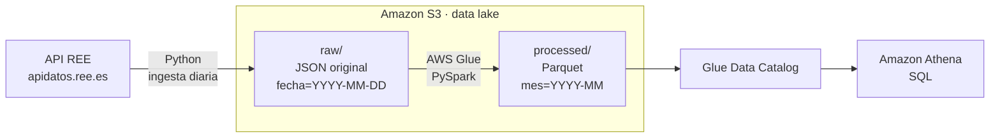

# ⚡ Data lake de precios de la electricidad en España

¿A qué hora es más barato poner la lavadora? ¿Cuánto más paga el consumidor con tarifa
regulada (PVPC) que lo que cuesta la energía en el mercado mayorista? Los datos para
responderlo los publica a diario **Red Eléctrica de España (REE)**, pero vienen en un JSON
anidado, día a día y en hora local con cambios de horario.

Este proyecto construye un **data lake en AWS** que recoge esos datos automáticamente, los
limpia y los deja listos para analizarlos con **SQL**, siguiendo las prácticas de un pipeline
de datos en producción: capas raw/processed, ingesta idempotente, controles de calidad,
infraestructura como código, tests y CI.

## Qué hace

1. **Ingesta:** un script en Python descarga cada día los precios desde la API pública de REE
   y guarda la respuesta original en S3 (capa *raw*).
2. **Transformación:** un job de **AWS Glue con PySpark** aplana el JSON, convierte las fechas a
   UTC, elimina duplicados, valida la calidad y escribe **Parquet particionado por mes**
   (capa *processed*).
3. **Análisis:** la tabla queda registrada en el **Glue Data Catalog** y se consulta con
   **Athena**: precio medio diario, horas más baratas, PVPC frente al mercado mayorista...

## Arquitectura

## Stack

| Área | Tecnologías |
|---|---|
| Lenguajes | Python 3.11, SQL |
| Procesamiento | PySpark 3.5 sobre AWS Glue 5.0 |
| Almacenamiento | Amazon S3 (JSON → Parquet con snappy) |
| Catálogo y consulta | AWS Glue Data Catalog (partition projection), Amazon Athena |
| Infraestructura | Terraform, IAM con mínimo privilegio |
| Calidad | pytest, moto (S3 simulado), PySpark local, ruff |
| CI/CD | GitHub Actions |

## Modelo de datos

Tabla `precios_electricidad`, con una fila por indicador y hora:

| Columna | Tipo | Descripción |
|---|---|---|
| `indicador_id` | string | `1001` = PVPC, `600` = mercado spot |
| `indicador` | string | Nombre del indicador |
| `fecha_hora_utc` | timestamp | Inicio de la franja, en UTC |
| `fecha` | date | Fecha en hora de Madrid |
| `hora` | int | Hora en hora de Madrid (0-23) |
| `precio_eur_mwh` | double | Precio en €/MWh |
| `mes` | string | Partición (`YYYY-MM`) |

## Decisiones técnicas

- **Datos originales sin tocar en *raw*:** si cambia la lógica de transformación, se puede
  reprocesar todo el histórico sin volver a llamar a la API.
- **Pipeline idempotente:** la ingesta escribe siempre en la misma clave para cada fecha y el
  job reescribe solo la partición del mes que procesa. Repetir una ejecución nunca duplica datos.
- **Particionado por mes y no por día:** un día son pocas decenas de filas. Particionar por día
  generaría miles de ficheros diminutos (el *small files problem*), que penaliza a Spark y a Athena.
- **Partition projection en lugar de crawlers:** Athena calcula las particiones a partir de
  la definición de la tabla, sin crawlers ni `MSCK REPAIR TABLE` y sin su coste.
- **Fechas en UTC y en hora local:** `fecha_hora_utc` es inequívoca incluso en los cambios de
  hora, mientras que `fecha` y `hora` siguen la hora de Madrid, que es como se consultan los precios.
- **Controles de calidad antes de escribir:** el job se detiene si no hay datos, si hay fechas
  ilegibles o si aparecen precios fuera de un rango razonable.
- **Lógica testeable:** la transformación son funciones PySpark puras, separadas del código de
  Glue, y se prueban en local y en cada push.
- **Seguridad y coste bajo control:** bucket privado y cifrado, role de Glue limitado a los
  prefijos que necesita, timeout en el job, límite de datos escaneados por consulta en Athena y
  borrado automático de ficheros temporales.

## Estado del proyecto

La infraestructura está definida y validada con Terraform (`terraform validate` en la CI) y se
puede desplegar con un solo comando. El coste estimado es de céntimos por ejecución. La ingesta
y la transformación se pueden ejecutar íntegramente en local, sin cuenta de AWS.

## Ejecutarlo

Las instrucciones paso a paso están en [`docs/EJECUCION.md`](docs/EJECUCION.md).

## Próximas mejoras

- Ingesta automática con AWS Lambda y EventBridge.
- Orquestación con Apache Airflow.
- Cruzar el precio con la generación por tecnología (renovables frente a fósiles).
- Dashboard en Metabase o QuickSight.

---

Datos: [REData API de Red Eléctrica de España](https://www.ree.es/es/datos/apidatos).
